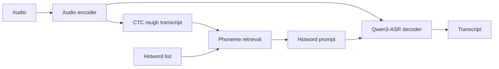

<div align="center">

# 🎙️ Qwen3-ASR Hotword vLLM

**Hotword-aware speech recognition with CTC, phoneme retrieval, and vLLM**

[Quick start](#-quick-start) · [Training](#-training) · [Tests](#-tests) · [Original repository](https://github.com/Xiaoxx18/qwen3_asr_context_deploy)

</div>

Based on [Xiaoxx18/qwen3_asr_context_deploy](https://github.com/Xiaoxx18/qwen3_asr_context_deploy), this independent repository adds a vLLM backend and a two-stage ms-swift training workflow. Given an external hotword list, it retrieves candidates using a CTC rough transcript and supplies them to Qwen3-ASR for final transcription.



## ✨ Features

- **Three modes:** `asr` for transcription, `ctc` for a rough transcript, and `ctc_rag` for retrieval-assisted transcription.
- **Shared audio encoding:** the vLLM worker reuses encoded features for CTC and final decoding, avoiding a second encoder pass.
- **External hotwords:** phoneme-based retrieval selects relevant terms from a UTF-8 text file, one term per line.
- **Training and evaluation:** prepare AISHELL-1 data, fine-tune a 0.6B model with ms-swift, train a CTC branch, and evaluate JSONL batches with corpus CER.

## 🚀 Quick start

Use a separate Python 3.10+ GPU environment. The vLLM adapter targets **vLLM 0.22.1** and **Transformers 4.57.6**; install CUDA-compatible vLLM and PyTorch builds for your system.

```bash
git clone https://github.com/wwhNLP/qwen3-asr-hotword-vllm.git
cd qwen3-asr-hotword-vllm
python -m pip install -e '.[vllm]'
```

Download a checkpoint with a trained CTC branch, such as the original author's [1.7B hotword model](https://huggingface.co/habagou/qwen3-asr-hotword-1.7B-ctc):

```bash
hf download habagou/qwen3-asr-hotword-1.7B-ctc \
  --local-dir ./ckpt/qwen3-asr-hotword-1.7B-ctc

CUDA_VISIBLE_DEVICES=0 python infer_vllm.py \
  --model ./ckpt/qwen3-asr-hotword-1.7B-ctc \
  --audio /path/to/audio.wav \
  --mode ctc_rag --hot-txt /path/to/hotwords.txt \
  --verify-encoder-reuse
```

`ctc` and `ctc_rag` require a checkpoint with a CTC branch. The included `hotword/hot.txt` is an example; replace it with a list relevant to your audio. `--verify-encoder-reuse` checks that each audio segment is encoded once.

For a JSONL batch, each record needs exactly one audio path; an optional assistant message supplies the reference for CER:

```json
{"uttid":"example","audios":["/path/to/audio.wav"],"messages":[{"role":"assistant","content":"reference transcript"}]}
```

```bash
CUDA_VISIBLE_DEVICES=0 python infer_vllm.py \
  --model ./ckpt/qwen3-asr-hotword-1.7B-ctc \
  --test-json /path/to/test.jsonl --mode ctc_rag \
  --hot-txt /path/to/hotwords.txt --batch-size 8 --out-json results.jsonl
```

The original Transformers entry point is `infer_ctc.py`; configure its hotword settings in the script and set `MODEL_PATH`, `MODE`, and optionally `TEST_JSON` via environment variables.

## 🏋️ Training

The [ms-swift + AISHELL-1 guide](docs/ms_swift_aishell.md) (Chinese) covers data preparation, hotword-aware SFT, CTC-only training, checkpoint export, and vLLM inference. It starts from the official Qwen3-ASR-0.6B base model. Use AISHELL-1 **train** for training and reserve the SeACo dev/test subsets for evaluation.

The 0.6B training → export → vLLM pipeline was smoke-tested for **two steps per training stage**; full AISHELL-1 training and resulting recognition quality have not been validated. The [upstream README](https://github.com/Xiaoxx18/qwen3_asr_context_deploy#readme) contains the original author's benchmark results, which are not results from this repository's 0.6B smoke test.

## 🧪 Tests

```bash
python -m unittest discover -s tests -v
```

GPU integration tests require real weights and audio, and run when configured in a vLLM environment:

```bash
CUDA_VISIBLE_DEVICES=0 VLLM_USE_FLASHINFER_SAMPLER=0 \
  VLLM_TEST_MODEL=/path/to/ctc-checkpoint VLLM_TEST_AUDIO=/path/to/audio.wav \
  python -m unittest discover -s tests -p test_vllm_integration.py -v
```

## 📌 Current limits

The vLLM adapter supports a **single GPU** and an **unquantized, merged checkpoint**. TP/PP, mixed multimodal requests, and loading LoRA adapters directly are not supported. Audio segments default to a maximum of 30 seconds; split longer recordings or adjust `--max-audio-seconds`. Encoded features pass through CPU memory between preparation and generation. Use `infer_vllm.py` for the complete hotword pipeline; `vllm serve` alone does not run its context preparation.

## 🙏 Credits and license

The original model implementation, retrieval approach, and reported experiments come from [Xiaoxx18/qwen3_asr_context_deploy](https://github.com/Xiaoxx18/qwen3_asr_context_deploy). This project also builds on [Qwen3-ASR](https://github.com/QwenLM/Qwen3-ASR), [SeACo-Paraformer](https://github.com/R1ckShi/SeACo-Paraformer), [asr-hotword](https://github.com/HaujetZhao/asr-hotword), and [FunASR](https://github.com/modelscope/FunASR).

The upstream repository currently has no declared license. Confirm the relevant permissions before using or redistributing its code; dependencies, datasets, and model weights have their own terms.
