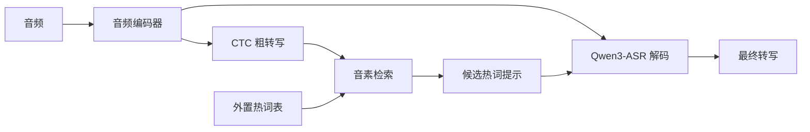

<div align="center">

# Qwen3-ASR Context Deploy

**用 CTC 粗转写与音素检索，为 Qwen3-ASR 提供可扩展的热词上下文**

`Qwen3-ASR` · `CTC` · `Phoneme RAG` · `vLLM` · `ms-swift`

[快速开始](#快速开始) · [vLLM 推理](#全流程-vllm-后端) · [模型训练](docs/ms_swift_aishell.md) · [实验结果](#实验结果)

</div>

基于 [Qwen3-ASR Context Deploy 原项目](https://github.com/Xiaoxx18/qwen3_asr_context_deploy)，
本仓库支持从外置词表检索相关候选词，再将候选词提供给 ASR 模型，帮助识别专名和罕见词。
同时提供 vLLM 推理适配，以及从 Qwen3-ASR-0.6B 出发的两阶段训练和导出流程。



> **验证范围**：原作者报告了下方的热词评测结果。本仓库已验证 0.6B 两阶段各 2 步的训练、导出和 vLLM 推理短流程；尚未完成 AISHELL-1 全量训练或验证其识别效果。

## 特性

- **三种推理模式**：`asr`（纯单遍转写）/ `ctc`（CTC 粗转写，快，不过 LLM）/ `ctc_rag`（CTC + 音素 RAG，推荐）。
- **一次编码器复用**：`ctc_rag` 全流程主模型 encoder 只过一次，CTC 与 LLM 两条路共享同一份编码器输出，不重复计算。
- **音素 RAG 检索**：两阶段检索（倒排索引粗筛 + 模糊音权重编辑距离精筛），支持前后鼻音、平翘舌等近音容错。
- **批量评测**：文件推理模式直接读 jsonl 批量转写并计算 CER。

## 环境依赖

从官方 **Qwen3-ASR-0.6B** 开始训练热词模型、训练 CTC 分支并导出到 vLLM 的步骤见
[ms-swift + AISHELL-1 训练说明](docs/ms_swift_aishell.md)。SeACo 提供的是 dev/test 评测子集；
训练使用 AISHELL-1 官方 train 划分，并通过本项目的 ms-swift external plugin 加载自定义 CTC 模型。

- Python 3.11+
- `torch`（GPU）、`transformers`、`qwen_omni_utils`、`flash-attn`（`flash_attention_2`）
- `pypinyin`（音素 RAG）

模型权重需为带 **CTC 分支** 的 checkpoint（`config.add_ctc_branch=True`）才能跑 `ctc` / `ctc_rag`；`asr` 模式任意 Qwen3-ASR 权重均可。

## 模型下载

热词微调权重（1.7B + CTC 分支，`th0.8/ctx8` 最佳配置对应模型）已发布到 Hugging Face：

- 🤗 **[habagou/qwen3-asr-hotword-1.7B-ctc](https://huggingface.co/habagou/qwen3-asr-hotword-1.7B-ctc)**

```bash
# 方式一：hf CLI 下载到本地目录
hf download habagou/qwen3-asr-hotword-1.7B-ctc --local-dir ./ckpt/qwen3-asr-hotword-1.7B-ctc

# 方式二：git lfs 克隆
git lfs install
git clone https://huggingface.co/habagou/qwen3-asr-hotword-1.7B-ctc
```

```python
# 方式三：Python 下载
from huggingface_hub import snapshot_download
path = snapshot_download("habagou/qwen3-asr-hotword-1.7B-ctc")
```

该权重带 CTC 分支（`config.add_ctc_branch=True`），可直接跑 `ctc` / `ctc_rag`；下载后把
`MODEL_PATH` 指向本地目录即可（见下方[快速开始](#快速开始)）。

## 快速开始

以下是 Transformers 推理入口。配置集中在 `infer_ctc.py` 顶部；其中 `MODEL_PATH`、`MODE`、`TEST_JSON`、`OUT_JSON` 可用环境变量覆盖：

| 变量 | 说明 |
|---|---|
| `MODEL_PATH` | 权重路径（`ctc`/`ctc_rag` 需带 CTC 分支） |
| `MODE` | `asr` \| `ctc` \| `ctc_rag` |
| `HOT_TXT` | `ctc_rag` 的大热词库（默认 `hotword/hot.txt`，需修改脚本配置） |
| `RAG_THRESHOLD` | 音素相似度阈值（默认 0.85，需修改脚本配置） |
| `MAX_CTX_HOTWORDS` | 每条最多注入的检索热词数（默认 10，需修改脚本配置） |
| `TEST_JSON` | 批量推理的 jsonl 路径（留空 = 单条样本模式） |
| `OUT_JSON` | 结果输出路径（留空自动放 `TEST_JSON` 同目录） |

```bash
# 单条样本（先填写文件末尾的 wav_path）
python infer_ctc.py

# 批量推理 jsonl 并计算 CER
TEST_JSON=/path/to/testset.jsonl python infer_ctc.py

# 指定模型 / 模式
MODEL_PATH=/path/to/ckpt MODE=ctc_rag python infer_ctc.py
```

批量推理的 jsonl 每行格式（`messages` 中 assistant 内容为参考文本，用于算 CER）：

```json
{"messages": [{"role": "assistant", "content": "参考转写"}], "audios": ["/abs/path.wav"], "uttid": "xxx"}
```

作为库调用：

```python
from infer_ctc import _load_model_processor, _get_vocab, _load_corrector, transcribe

model, processor = _load_model_processor()
vocab = _get_vocab()        # ctc / ctc_rag 需要
pc = _load_corrector()      # 仅 ctc_rag 需要
out = transcribe(model, processor, "/path/to/x.wav", mode="ctc_rag", vocab=vocab, pc=pc)
print(out["text"])          # ctc_rag 还含 out["rough"]（CTC 粗转写）/ out["hotwords"]（检索热词）
```

## 全流程 vLLM 后端

新增 `infer_vllm.py` / `qwen3_asr_vllm`，直接加载**带 CTC 分支的完整 checkpoint**，不需要删除
`thinker.ctc_branch.*`，也不启动 Transformers 推理模型。音频编码器、CTC 分支和文本解码器
均由同一个 vLLM worker 持有，音素 RAG 也在该 worker 内运行。

```text
vLLM worker: Mel → 音频编码器 → CTC → 音素 RAG → 热词提示
                           └→ 编码特征 ─────────→ vLLM 最终生成
```

准备阶段通过命名的 `LLM.collective_rpc()` worker 扩展执行；最终通过 `LLM.generate()` 传入预计算音频 embedding。
RPC 仅传输数据，不需要开启 vLLM 的不安全 pickle 序列化选项。
生成阶段跳过音频编码器，因此每条音频只编码一次。当前跨进程传递会将编码特征复制到 CPU，
再由 vLLM 送回 GPU；这部分传输有开销，但不会重新编码，也不会再次提取 Mel。

当前适配固定 **vLLM 0.22.1 / Transformers 4.57.6**，支持单 GPU、未量化的合并权重，提供
`asr` / `ctc` / `ctc_rag` 三种模式和 JSONL 批量推理。暂不支持 TP/PP、多模态混合请求或 LoRA
adapter 直接加载。默认单段音频上限 30 秒，超长音频先切段；可通过 `--max-audio-seconds` 调整。
批量推理逐条准备音频上下文，再将最终文本解码交给 vLLM 批量调度。
基座模型输出的 `language …<asr_text>` 前缀会自动剥离；带参考文本的 JSONL 推理会输出
去除空白和标点后的整体 CER（总编辑距离 / 总参考字符数）。

使用独立的 Python 3.10+ 环境安装，避免改变原有 HF 环境：

```bash
python -m pip install -e '.[vllm]'
```

vLLM/PyTorch 的 CUDA 构建需与本机驱动匹配。CUDA 12 环境可以先安装官方
[vLLM 0.22.1 cu129 wheel](https://github.com/vllm-project/vllm/releases/tag/v0.22.1)
及兼容的 PyTorch CUDA 12 构建，再执行上述安装命令。
本入口使用贪婪解码，可设置 `VLLM_USE_FLASHINFER_SAMPLER=0` 使用 vLLM 内置采样路径，
跳过启动时 FlashInfer 采样器的 JIT 编译。

```bash
# 热词检索 + 最终转写，检查每条音频恰好编码一次
CUDA_VISIBLE_DEVICES=0 python infer_vllm.py \
  --model /path/to/ctc-checkpoint --audio /path/to/example.wav \
  --mode ctc_rag --hot-txt hotword/hot.txt --verify-encoder-reuse

# 只跑 CTC（仍由 vLLM worker 执行）
CUDA_VISIBLE_DEVICES=0 python infer_vllm.py \
  --model /path/to/ctc-checkpoint --audio /path/to/example.wav --mode ctc

# 批量推理，输入格式与原入口相同，输出含 ref/text/rough/hotwords
CUDA_VISIBLE_DEVICES=0 python infer_vllm.py \
  --model /path/to/ctc-checkpoint --test-json /path/to/test.jsonl \
  --mode ctc_rag --batch-size 8 --out-json /path/to/results.jsonl
```

也可以作为库调用；使用 `if __name__ == '__main__'` 保护 vLLM 的 worker 启动：

```python
from qwen3_asr_vllm import VLLMContextASR

if __name__ == '__main__':
    engine = VLLMContextASR('/path/to/ctc-checkpoint', mode='ctc_rag')
    print(engine.transcribe('/path/to/example.wav'))
    # ndarray 输入须为 16 kHz、单声道 float32；文件输入自动转单声道并重采样。
```

模型插件通过 `pip install -e` 注册到 `vllm.general_plugins`，保证子进程能够发现自定义架构。
`vllm serve` 本身不会运行两阶段上下文准备；完整热词流程使用本项目的新入口。

已使用 `habagou/qwen3-asr-hotword-1.7B-ctc` 的真实权重在 NVIDIA A800 上验证，测试环境为
Python 3.10、PyTorch 2.11.0+cu128、vLLM 0.22.1+cu129、BF16。GPU 回归测试逐项核对了全部
84 个 CTC 权重张量（包含 Q/K/V 合并），覆盖热词命中后的最终生成和不同音频长度的批量请求；
每条音频的编码器调用次数均为 1。默认 `torch.compile` 和 CUDA Graph 推理路径也已完成单条验证。

```bash
# 普通回归测试；没有配置真实权重时跳过 GPU 集成测试
python -m unittest discover -s tests -v

# 在已安装 vLLM 的环境中执行真实权重 GPU 集成测试
CUDA_VISIBLE_DEVICES=0 VLLM_USE_FLASHINFER_SAMPLER=0 \
  VLLM_TEST_MODEL=/path/to/ctc-checkpoint VLLM_TEST_AUDIO=/path/to/mandarin.wav \
  python -m unittest discover -s tests -p test_vllm_integration.py -v
```

## 三种模式

- **`asr`**：纯单遍主模型转写（等价基础 `infer.py`）。可选把 `HOTWORDS` 手动拼进 `system`。
- **`ctc`**：只跑 CTC 分支贪婪解码出粗转写（快，不过 LLM），常用于调试 / 测速。
- **`ctc_rag`**（推荐）：CTC 粗转写 → `PhonemeCorrector` 音素检索相关热词 → 注入 `system` → 主模型正式转写。

### 热词 RAG 机制

`hotword/` 实现两阶段音素检索：`FastRAG` 用首音素倒排索引 + 锚点搜索快速粗筛候选，
再用带近音权重（前后鼻音 / 平翘舌等相似音集合权重 0.5）的模糊编辑距离精筛，命中并替换粗转写中的近音片段。
只把少量真正相关的热词注入 `system`，避免全量注入带来的「过纠 / 虚报」。

RAG 纠错样例（CTC 粗转写 → 检索热词 → 终稿）：

| CTC 粗转写 | 检索到的热词 | 终稿（正确） |
|---|---|---|
| ...副所长邓**玉松**认为 | 邓郁松 | ...副所长邓**郁松**认为 |
| **朱胜伟**曝王思聪... | 朱圣祎 | **朱圣祎**曝王思聪... |
| 玩新大旗的**许少阳**... | 许绍洋 | 玩心大起的**许绍洋**... |

## 模型架构（`qwen3_asr_model/`）

Qwen3-ASR 的 HF 自定义实现：音频编码器 + 文本解码器（thinker），外挂一个**可选 CTC 分支**
（`Qwen3ASRCTCBranch`，`config.add_ctc_branch=True` 时创建），复用 SeACo-Paraformer 的 vocab8404 字表做贪婪解码。
使用前需调用 `register_qwen3_asr()` 把类注册到 `AutoConfig` / `AutoModelForSeq2SeqLM` / `AutoProcessor`（`infer_ctc.py` 已自动完成）。

---

## 实验结果

> 以下为原项目作者报告的结果，使用 SeACo-Paraformer 风格的 Qwen3-ASR 热词定制评测（AISHELL-1 命名实体子集）和 [SeACo-Paraformer](https://github.com/R1ckShi/SeACo-Paraformer.git) 的测试集与评测方法。它们不是本仓库 0.6B 短流程训练的实测结果。

**评测数据**

| 测试集 | #utt | #hotwords | #R1 难热词 |
|---|---|---|---|
| Test-Aishell1-NE | 808 | 400 | 226 |
| Dev-Aishell1-NE  | 1334 | 600 | 371 |

- R1 难热词：在通用 ASR 模型上召回率 < 40% 的热词。
- 两种条件：**no hotword**（`system` 为空，纯转写基线）与 **+hotword**（整份热词库注入，或 CTC+RAG 检索式注入）。
- 指标口径与 SeACo 论文一致：整体 CER + 热词 Recall / Precision / F1（基于非重叠出现次数统计 hit/miss/fa）。

### Test-Aishell1-NE（808 utt，400 热词 / 226 R1 热词）

| 模型 | 条件 | CER | 全量热词 R/P/F1 | R1 热词 R/P/F1 |
|---|---|---|---|---|
| SeACo-Paraformer+ASF（论文 Result1） | 检索式热词 | 2.27% | 94 / 97 / 96 | 87 / 97 / 92 |
| **hot-0.6B-lr2e-6-ctc-graft** | **CTC+音素RAG** | **2.18%** | **95.8 / 95.7 / 95.7** | **92.5 / 95.9 / 94.2** |
| **hot-1.7B-lr2e-6-ctc**（th0.75/ctx20） | **CTC+音素RAG** | **1.49%** | **98.4 / 96.4 / 97.4** | **96.4 / 97.2 / 96.8** |
| **hot-1.7B-lr2e-6-ctc**（th0.8/ctx8） | **CTC+音素RAG** | **1.39%** | **98.3 / 96.9 / 97.6** | **96.9 / 98.0 / 97.5** |

> 基座模型输出带 `language Chinese<asr_text>…` 模板前缀，评测前已剥离（否则 CER 会被模板串污染）；热词微调模型直接输出纯文本。

### Dev-Aishell1-NE（1334 utt，600 热词 / 371 R1 热词）

| 模型 | 条件 | CER | 全量热词 R/P/F1 | R1 热词 R/P/F1 |
|---|---|---|---|---|
| SeACo-Paraformer+ASF（论文 Result1） | 检索式热词 | 1.98% | 94 / 99 / 96 | 86 / 98 / 92 |
| **hot-0.6B-lr2e-6-ctc-graft** | **CTC+音素RAG** | **2.39%** | **95.5 / 94.1 / 94.8** | **92.7 / 92.7 / 92.7** |
| **hot-1.7B-lr2e-6-ctc**（th0.75/ctx20） | **CTC+音素RAG** | **1.56%** | **97.2 / 96.0 / 96.6** | **95.0 / 95.3 / 95.2** |
| **hot-1.7B-lr2e-6-ctc**（th0.8/ctx8） | **CTC+音素RAG** | **1.55%** | **97.1 / 96.2 / 96.6** | **95.9 / 95.5 / 95.7** |

### 结论

1. **热词注入显著提升召回**：热词微调模型注入 400 热词后，全量热词召回 57.6% → **81.9%**（+24.3），R1 难热词召回 24.9% → **67.0%**（+42.2）。
2. **基座模型几乎不吃热词提示**：通用 Qwen3-ASR-0.6B 注入同样热词召回仅 +3~6 个点，说明是「热词微调」而非「更大通用模型」带来定制能力。
3. **全量注入有过纠代价**：每条注入全部 400 热词属强偏置，CER 6.5% → 10.9%（与论文「热词表越大越受干扰」趋势一致）。
4. **CTC + 音素 RAG 同时拿到最高召回与最低 CER**：每条只注入平均 9.3 个真正相关热词，全量召回 **95.8%** / R1 召回 **92.5%**，CER 仅 **2.18%**，显著优于全量注入的 81.9 / 67.0 / 10.9%。
5. **1.7B + 收紧检索（th0.8/ctx8）为当前最佳**：Test CER **1.39%** / 全量 F1 **97.6** / R1 F1 **97.5**，全面超过论文 SeACo+ASF。

**检索参数消融**：把阈值 0.75→**0.8**、每条上限 20→**8**（少塞近音干扰项）后，几乎全面变好而非简单的 P↑R↓ 权衡 —— 减少注入的近音候选，能在不掉召回的前提下同时降低 CER、抬高精确率。

---

## ContextASR-Bench 评测结果（Speech-Mandarin）

在 [ContextASR-Bench](https://github.com/MrSupW/ContextASR-Bench) 的 **ContextASR-Speech / Mandarin** 子集（**15498** 条，覆盖 10+ 领域、大量命名实体）上评测同一权重 **qwen3-asr-hot 1.7B**。
以下数据同样来自原项目作者报告，并非本仓库 0.6B 短流程的测量结果。
论文要求单段音频 ≤30s，故先用 FunASR `fsmn-vad` 做端点检测并贪心合并到 ≤30s（15498 条 → 47908 chunk，平均 3.09 chunk/条），逐段转写后拼接。

- **Contextless**：`system` 为空的纯转写基线。
- **Fine-grained**：把该条音频的 `entity_list`（平均 ~6 个 NE）按训练格式注入 `system`（`可能出现的热词：<ents>`）。

| 设置 | WER ↓ | NE-WER ↓ | NE-FNR ↓ |
|---|---|---|---|
| Contextless（无上下文） | **2.02%** | **11.23%** | **13.90%** |
| Fine-grained（注入实体列表） | **1.72%** | **7.34%** | **0.38%** |

**与论文 Table 2（ContextASR-Speech-ZH，WER / NE-WER / NE-FNR，%）对比**

| 模型 | 规模 | Contextless | Fine-grained |
|---|---|---|---|
| Paraformer-Large | 220M | 5.62 / 28.68 / 55.71 | —（无指令跟随） |
| FireredASR-LLM-L | 8.3B | 2.83 / 16.14 / 26.75 | — |
| Qwen2-Audio | 8.4B | 10.14 / 28.73 / 41.45 | 9.92 / 24.10 / 30.02 |
| Baichuan-Audio | 10.4B | 7.30 / 14.19 / 17.64 | 2.16 / 6.65 / 2.35 * |
| Kimi-Audio | 9.8B | 2.60 / 16.49 / 27.84 | 1.95 / 11.13 / 15.28 |
| Qwen2.5-Omni-3B | 5.4B | 3.48 / 20.68 / 37.44 | 2.13 / 10.55 / 14.11 |
| Qwen2.5-Omni-7B | 10.1B | 2.59 / 19.05 / 33.88 | 1.84 / 9.80 / 12.19 |
| **本模型 qwen3-asr-hot** | **1.7B** | **2.02 / 11.23 / 13.90** | **1.72 / 7.34 / 0.38** |

`*` 论文标注 Baichuan-Audio 在 Fine-grained 下存在严重幻觉（hallucination）。

**结论**

1. **Contextless**：本模型（1.7B）WER **2.02%** / NE-WER **11.23%** / NE-FNR **13.90%**，三项均优于表中所有模型（含 8~10B 的 Kimi-Audio、Qwen2.5-Omni-7B、FireredASR-LLM-L），且参数量最小。
2. **Fine-grained**：WER **1.72%** 优于 Qwen2.5-Omni-7B(1.84) / Kimi-Audio(1.95)；NE-WER **7.34%** 优于所有无幻觉模型（次优 Qwen2.5-Omni-7B 9.80）；NE-FNR **0.38%** 大幅领先（最好的非幻觉模型为 12.19）—— 注入实体后几乎不漏识 NE。
3. 以 **1.7B** 体量取得该子集 SOTA 级表现，进一步印证热词注入（`system` 前缀）训练范式在上下文 ASR 上的有效性。

---

## 致谢 / Acknowledgements

本仓库基于 [Xiaoxx18/qwen3_asr_context_deploy](https://github.com/Xiaoxx18/qwen3_asr_context_deploy)，感谢原作者提供模型、检索方案和评测结果。原仓库目前未附带许可证；使用和再分发相关代码前请确认权利许可。各依赖、数据集与模型权重分别遵循其各自的使用条款。

本项目还建立在多个优秀工作之上，特此致谢：

- [Qwen3-ASR](https://github.com/QwenLM/Qwen3) — 提供强大的多模态语音识别基座模型与训练框架。
- [SeACo-Paraformer](https://github.com/R1ckShi/SeACo-Paraformer) — 检索式热词定制的评测集、评测口径与思路来源。
- [ContextASR-Bench](https://github.com/MrSupW/ContextASR-Bench) — 上下文语音识别评测基准（WER / NE-WER / NE-FNR）与打分脚本。
- [asr-hotword](https://github.com/HaujetZhao/asr-hotword) — 本项目 `hotword/` 音素纠错模块（`PhonemeCorrector` / FastRAG / 音素编辑距离）基于该库。
- [FunASR](https://github.com/modelscope/FunASR) — CTC 分支复用其 SeACo-Paraformer `vocab8404` 字表与 `seg_dict` 切分逻辑。
- [pypinyin](https://github.com/mozillazg/python-pinyin) — 音素 RAG 检索的拼音 / 音素转换基础。

This project builds upon several outstanding works. We thank the authors of **Qwen3-ASR**, **SeACo-Paraformer**, **asr-hotword**, **FunASR**, and **pypinyin** for their contributions.
