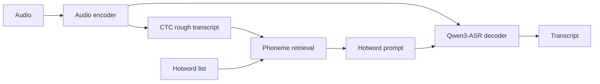

<div align="center">

# 🎙️ Qwen3-ASR Hotword Toolkit

**Hotword-aware speech recognition with CTC, phoneme retrieval, and vLLM**

[Background](#-background) · [Quick start](#-quick-start) · [Training](#-training) · [Tests](#-tests) · [Original repository](https://github.com/Xiaoxx18/qwen3_asr_context_deploy)

</div>

## 💡 Background

Qwen3-ASR can struggle with names and domain-specific terms, and providing hotwords in the prompt alone may not reliably improve their recognition. This project explores hotword-aware fine-tuning and retrieval to make better use of an external vocabulary.

The original [Qwen3-ASR Context Deploy](https://github.com/Xiaoxx18/qwen3_asr_context_deploy) combines a hotword-fine-tuned model with a CTC branch and phoneme-based retrieval: it creates a rough transcript, selects relevant terms from a hotword list, and supplies them to Qwen3-ASR for final transcription.

This repository builds on that work with:

- A **vLLM backend** for the CTC, retrieval, and transcription pipeline, reusing the same audio encoding for CTC and final decoding.
- A **two-stage ms-swift workflow** to fine-tune Qwen3-ASR-0.6B for hotword prompts, train a CTC branch, and export the checkpoint for vLLM.
- **Robustness fixes and tests** for training, inference, and hotword retrieval, plus JSONL batch evaluation with corpus CER.

The vLLM pipeline has been tested with the original author's 1.7B checkpoint and a locally trained 0.6B CTC checkpoint. The 0.6B recognition quality has not yet been established by a full evaluation.



## ✨ Features

- **Three modes:** `asr` for transcription, `ctc` for a rough transcript, and `ctc_rag` for retrieval-assisted transcription.
- **Shared audio encoding:** the vLLM worker reuses encoded features for CTC and final decoding, avoiding a second encoder pass.
- **External hotwords:** phoneme-based retrieval selects relevant terms from a UTF-8 text file, one term per line.
- **Online API:** batch concurrent requests, replace the global vocabulary without restarting, and override it per request. A Python/CLI client is included; see the [server guide](docs/vllm_server.md).
- **Training and evaluation:** prepare AISHELL-1 data, fine-tune a 0.6B model with ms-swift, train a CTC branch, and evaluate JSONL batches with corpus CER.

## 🚀 Quick start

The locked deployment uses **Python 3.12, vLLM 0.23.0 and CUDA 12.9** on Linux x86-64. Install [uv](https://docs.astral.sh/uv/getting-started/installation/) and use an NVIDIA GPU with a compatible driver.

```bash
git clone --branch dev https://github.com/wwhNLP/qwen3-asr-hotword-toolkit.git
cd qwen3-asr-hotword-toolkit
UV_PROJECT_ENVIRONMENT=.venv-uv uv sync --locked --extra vllm --extra server --extra client
source .venv-uv/bin/activate
```

`uv.lock` pins the CUDA 12.9 vLLM and PyTorch wheels; `vllm023` remains an alias for `vllm`. The separate `.venv-uv` avoids changing an existing training environment. See the [vLLM 0.23 setup guide](docs/vllm_023.md) for offline installation and compatibility details.

Download the [fine-tuned 0.6B CTC checkpoint on ModelScope](https://www.modelscope.ai/models/wwhnlp/Qwen3-ASR-0.6B-CTC-Hotword):

```bash
uvx --from modelscope==1.37.0 modelscope download \
  --model wwhnlp/Qwen3-ASR-0.6B-CTC-Hotword \
  --endpoint https://www.modelscope.ai --local_dir ./checkpoint

./scripts/serve.sh
```

The startup configuration is in `scripts/serve.sh`: GPU 0, port 8900, batching and memory limits are set there. The global vocabulary is empty by default. Set `HOTWORD_FILE="$PROJECT_DIR/train_hotwords.txt"` in the script to load a domain vocabulary, or supply words per request. The server checks the checkpoint and uses offline model loading. `ctc` and `ctc_rag` require a checkpoint with a CTC branch.

The online server supports `--mode asr`, `--mode ctc`, and `--mode ctc_rag`. Uppercase Latin acronyms such as `GPU` also get a common Chinese letter-name reading for retrieval; add explicit aliases such as `Claude|克劳德` for other pronunciations. Selected, unambiguous explicit aliases are replaced literally in the final transcript; choose aliases carefully, since an alias may also occur with another meaning. Automatic acronym readings and fuzzy phonetic matches are retrieval-only. Blacklists suppress replacements conservatively.

Responses report the number of injected words, literal hits and alias replacements. `/v1/metrics` aggregates those counts, successful requests and length-truncated results for the current server process. A literal hit only means that the word appears in the output; it does not establish correctness. For long audio, the client seeks a nearby quiet interval before each maximum-length boundary and reports `truncated` if any segment reaches the decoder limit. Continuous speech still falls back to fixed boundaries.

For a JSONL batch, each record needs one audio path. An optional assistant message supplies the reference for CER. Individual records can provide a vocabulary and inference limits:

```json
{"uttid":"example","audios":["/path/to/audio.wav"],"hotwords":["广州","康辉|康灰"],"max_ctx_hotwords":2,"max_new_tokens":64,"messages":[{"role":"assistant","content":"reference transcript"}]}
```

```bash
CUDA_VISIBLE_DEVICES=0 python infer_vllm.py \
  --model ./checkpoint \
  --test-json /path/to/test.jsonl --mode ctc_rag \
  --hot-txt /path/to/hotwords.txt --batch-size 8 --out-json results.jsonl
```

In `ctc_rag` mode, request `hotwords` replace the default `--hot-txt` vocabulary for that audio; retrieval selects up to `max_ctx_hotwords` matches. For a request containing at most four entries, remaining slots are filled with explicitly supplied words without blacklists, even when CTC misses them. Use a focused list to avoid irrelevant prompts. Omit the field or use `null` for the default vocabulary, and use `[]` to disable hotwords for that audio. The same fields can be supplied from Python:

```python
from qwen3_asr_vllm.runtime import VLLMContextASR

engine = VLLMContextASR("/path/to/checkpoint", mode="ctc_rag")
result = engine.transcribe("/path/to/audio.wav", hotwords=["广州", "康辉"],
                           max_ctx_hotwords=2, max_new_tokens=64)
batch = engine.transcribe_batch(["/path/a.wav", "/path/b.wav"], request_options=[
    {"hotwords": ["广州"], "max_ctx_hotwords": 1},
    {"hotwords": ["康辉"], "max_new_tokens": 64},
])
```

`--hotword` may be repeated to set a shared request vocabulary; JSONL records can override it. In `asr` mode these words are supplied directly in the prompt. Pure `ctc` mode rejects request hotwords and generation options. Bounded caches reuse request vocabulary indices and phonemes: `--request-cache-size 8` is the default and `0` disables reuse between calls. Index memory is larger than the cached vocabulary text size. Python callers can inspect `engine.request_cache_info()` or clear both caches with `engine.clear_request_cache()`.

See the [request options guide](docs/request_options.md) for per-audio overrides, cache behavior and benchmarking.

The original Transformers entry point is `infer_ctc.py`; configure its hotword settings in the script and set `MODEL_PATH`, `MODE`, and optionally `TEST_JSON` via environment variables.

Both inference entry points reject output paths that alias the input manifest or any input audio, including symbolic and hard links. In `infer_ctc.py`, each batch result has a `status` (`ok` or `error`); failures include the exception type and message in `error` and use `hyp: null`. CER counts only successful records with a reference transcript. Missing references and failed records have `err: null` and `ref_len: null`; an explicitly empty reference still counts insertions. The console reports failed and scored sample counts separately. When there are no scored reference characters, CER is `N/A` and `run_file` returns `None`.

## 🏋️ Training

The [ms-swift + AISHELL-1 guide](docs/ms_swift_aishell.md) (Chinese) covers data preparation, hotword-aware SFT, CTC-only training, checkpoint export, and vLLM inference. It starts from the official Qwen3-ASR-0.6B base model. Use AISHELL-1 **train** for training and reserve the SeACo dev/test subsets for evaluation.

The 0.6B training → export → vLLM pipeline was initially smoke-tested for **two steps per training stage**. A completed local AISHELL-1 checkpoint was later used for [latency measurements](docs/vllm_optimization.md); corpus-level recognition quality has not yet been evaluated. The [upstream README](https://github.com/Xiaoxx18/qwen3_asr_context_deploy#readme) reports the original author's recognition benchmarks.

## 🧪 Tests

```bash
python -m unittest discover -s tests -v
```

GPU integration tests require real weights and audio, and run when configured in a vLLM environment:

```bash
CUDA_VISIBLE_DEVICES=0 VLLM_USE_FLASHINFER_SAMPLER=0 \
  VLLM_TEST_MODEL=/path/to/ctc-checkpoint VLLM_TEST_AUDIO=/path/to/audio.wav \
  python -m unittest discover -s tests -p test_vllm_integration.py -v
```

## 📌 Current limits

The vLLM adapter supports a **single GPU** and an **unquantized, merged checkpoint**. TP/PP, mixed multimodal requests, and loading LoRA adapters directly are not supported. Audio segments default to a maximum of 30 seconds; split longer recordings or adjust `--max-audio-seconds`. Use `infer_vllm.py` for the complete hotword pipeline; `vllm serve` alone does not run its context preparation.

Audio encoding and CTC run in microbatches (`--prepare-batch-size 4`). For larger batches, CPU hotword retrieval overlaps preparation of the next microbatch. Features stay on the worker GPU by default; only IDs and lengths cross the process boundary. A 256 MiB request cache is released after generation, including on errors. `--embedding-transport cpu` provides the original feature-transfer path for comparison. `--batch-size` controls the number of utterances submitted together for final decoding.

Hotword coarse scoring uses up to four native CPU workers (`--rag-workers 4`), including for single audio; small workloads automatically use serial scoring. Use `--rag-workers 1` to always score serially. Matching scores and candidate order are preserved; each score matrix is limited to 16 MiB.

Weighted refinement uses Numba when available (`--rag-refiner auto`, the default). Vocabulary loading prepares the compiled kernel before inference. Select `python` or `numba` explicitly for comparisons. The vLLM extra includes Numba; standalone hotword users can install `.[rag-native]`.

See the [latency measurements and vLLM 0.26 migration assessment](docs/vllm_optimization.md) for validation, limits, and a repeatable benchmark. The locked deployment targets **vLLM 0.23.0**; 0.22.1 results are historical.

## 🙏 Credits and license

The original model implementation, retrieval approach, and reported experiments come from [Xiaoxx18/qwen3_asr_context_deploy](https://github.com/Xiaoxx18/qwen3_asr_context_deploy). This project also builds on [Qwen3-ASR](https://github.com/QwenLM/Qwen3-ASR), [SeACo-Paraformer](https://github.com/R1ckShi/SeACo-Paraformer), [asr-hotword](https://github.com/HaujetZhao/asr-hotword), and [FunASR](https://github.com/modelscope/FunASR).

The upstream repository currently has no declared license. Confirm the relevant permissions before using or redistributing its code; dependencies, datasets, and model weights have their own terms.
